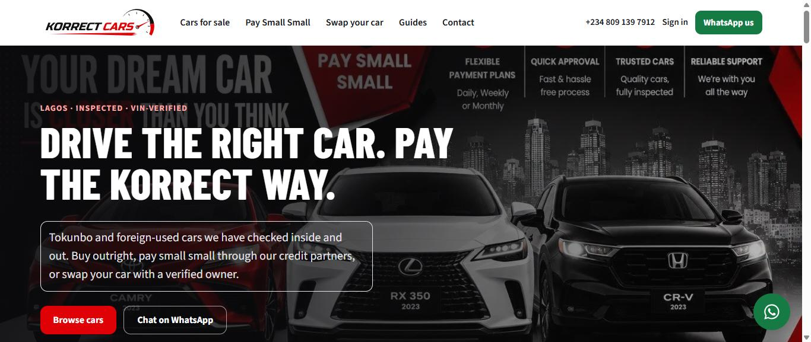
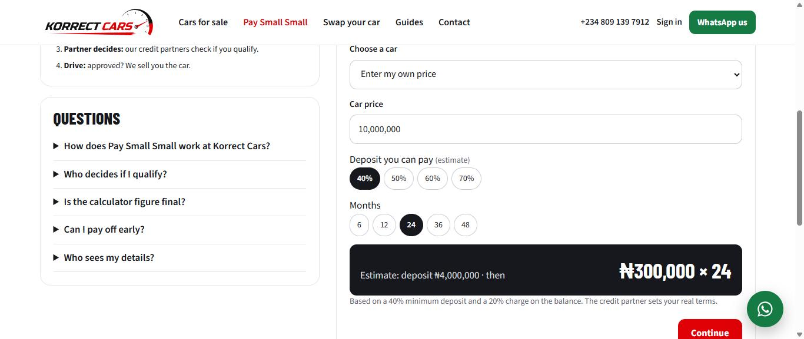
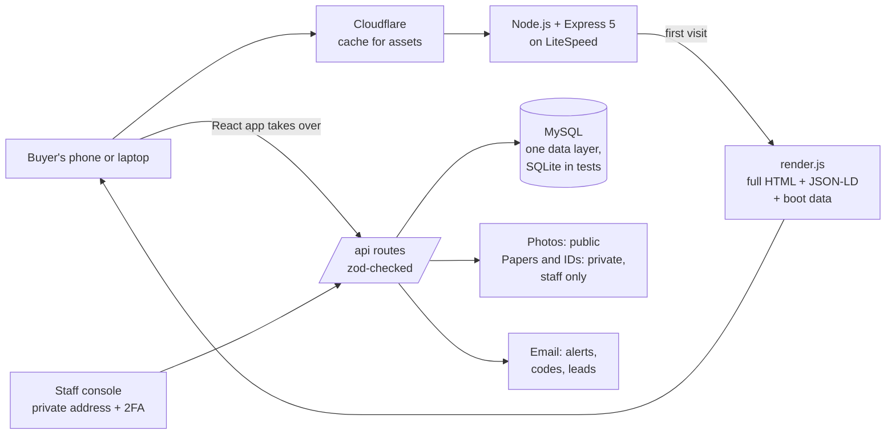

# Korrect Cars

**Live: [korrectcars.com](https://www.korrectcars.com)**, a car marketplace for Lagos, Nigeria. Buyers pay cash, pay in instalments through credit partners ("Pay Small Small"), or swap their car with another owner. Korrect Cars and verified partner dealers list on the same site.

I rebuilt it from WordPress into a custom Node.js, Express, React and MySQL app, and I run it in production: real stock, real buyer enquiries, staging before every release.

| Home page | Pay Small Small calculator |
| --- | --- |
|  |  |

## At a glance

- **Marketplace:** Korrect Cars' own stock plus partner dealers and private sellers. Each seller works in their own account, with owner, manager and lister roles.
- **Three ways to buy:** cash, Pay Small Small instalments, and Korrect Swap (owner to owner, with Korrect Cars in the middle).
- **One live listing per car:** the VIN register blocks a second seller from listing a car that is already live.
- **Staff console:** cars, leads, seller checks, reported listings, boosts and site settings, behind a private address and two-step sign-in.
- **Search and AI search:** server-rendered pages, JSON-LD for every car, a sitemap, `llms.txt` and IndexNow.
- **Checks on every push:** TypeScript over the server code, 88 API tests and Playwright browser tests on a phone and a desktop screen, plus a Docker start-up test.
- **13 numbered database changes** in `server/migrations`, run at start-up under a lock so two app processes never apply one twice.

## How it fits together

A request for a page gets complete HTML first (`server/render.js`), so search engines, AI assistants and slow phones see every car, price and spec without running any JavaScript. The React app then loads and takes over. All writes go through `/api`, where Zod checks every body and the session decides which seller's data a request may touch.

[docs/ARCHITECTURE.md](docs/ARCHITECTURE.md) has the full map: business rules, every folder, how a request flows, and how to find and fix a bug.

## Engineering decisions

- **MySQL, with SQLite in tests.** The host offers MySQL, so production uses it. `server/db.js` runs the same SQL on Node's built-in SQLite for tests, so the 88 API tests need no database server.
- **Seller data stays apart in one place.** Seller routes take the seller account from the signed-in session, never from the request, and add `dealer_id = ?` to every query and update. A test signs in as one seller and tries to read, edit and sell another seller's car; each attempt must return 404.
- **One live listing per VIN.** A unique register sits under every listing. A second seller who tries to list a live car gets a `VIN_TAKEN` refusal.
- **Contact numbers.** A partner's own number appears on their car page and seller page only. List pages carry Korrect Cars' number, and the WhatsApp button on a partner's card looks the number up when tapped (`/api/wa/:slug`), so list pages never hold a seller's number. A sitemap-wide scan in November 2026 found the leak this fixes; a test now guards it.
- **Small database pools.** The host allows 8 connections per database user and LiteSpeed can run several copies of the app. Each copy keeps 2 connections, retries "too many connections" twice, and closes its pool on shutdown. `scripts/restart-app.sh` waits for the new copy before stopping old ones.
- **One Pay Small Small formula.** The browser and the server share one rule (minimum deposit from Settings, 24 months for the headline figure), so cards, car pages, search results and `llms.txt` always show the same estimate, with the total paid and the extra over the cash price.
- **TypeScript checking without a rewrite.** `tsconfig.json` turns on `checkJs` over the server's JavaScript, with types for what the middleware adds to requests (`server/types/express.d.ts`). The site gets type checks in CI while the live code stays as it is.
- **Releases.** Every change goes to a private staging copy first, then live. The live database is backed up before each update, and commits made on the server are GPG-signed.

## Search and AI search

- Every public page arrives as full HTML with a unique title, description, canonical link and Open Graph tags.
- Car pages carry `Car` structured data (price, year, mileage when known, engine); dealers carry `AutoDealer`; guides carry `BlogPosting`; FAQs carry `FAQPage`.
- `/llms.txt` gives AI assistants a plain summary of the business, the stock and the Pay Small Small rule, from the same data as the pages.
- New and changed cars go to search engines through IndexNow; the sitemap leaves out empty categories until a car arrives.

## Features in detail

Every feature, with the file that holds it

- **Car listings** with search, imported from the old WordPress site
- **Homepage by category:** rows for New arrivals, Featured, Under ₦20m, SUVs, Sedans, Premium (₦30m+), Electric & hybrid and Recently sold. A row only appears when it has at least 3 cars, and one car shows in at most 2 rows
- **Category pages** at `/cars/<category>` (for example `/cars/suv`, `/cars/under-20-million`), each with its own title, intro, price answer and structured data for Google and AI assistants
- **"Recommended" order** on Cars for sale (the default): a shuffle that is different for each visitor and changes daily, so every car gets seen, not only the most expensive ones. New arrivals (last 21 days) and featured cars get a head start; sold cars always go last. The other sorts (price, year, recently added) are still in the Sort menu
- **Pay Small Small:** an instalment calculator (40% minimum deposit, 6 to 48 month terms) and a 3-step application sent to credit partners
- **Korrect Swap:** peer-to-peer car exchange, with private document uploads visible only to staff
- **Accounts** with email verification, plus two-factor login (TOTP)
- **Dealer logos:** dealers add a logo when they register their business or later from My seller page (owner or manager; JPG, PNG or WEBP under 2 MB, checked by its real bytes). It shows on their public seller page and in its AutoDealer structured data; staff can take one down from Sellers to review
- **Saved-car alerts:** signed-in buyers get an email when a car they saved drops in price (by ₦50,000 or more, never twice for the same price), gets new photos (at most weekly) or is sold (once, with up to 3 similar cars). The seller who made the change is not emailed; buyers switch it off in Account > Saved cars (`server/lib/car-alerts.js`, migration 012)
- **Recently viewed:** the homepage shows up to 4 cars the visitor opened (still for sale, newest first), kept in their browser only (`kc-viewed`, max 12). A swipe row on phones; a Clear button empties it
- **Save-search prompt:** on a filtered car list, a small card offers an email alert after 20 seconds or a long scroll. It shows once per search per visit, never over the cookie bar, and "No thanks" hides it for the visit. Signed-out visitors sign in and come back with `?kcsave=1`, which saves the search for them (`SaveSearchPrompt` in `client/src/pages/Cars.jsx`)
- **Installable site (PWA):** `/manifest.webmanifest` (`server/lib/pwa.js`), app icons in `client/public/img/icons`, and a service worker (`client/sw.js`, built into `dist/sw.js` with the build version, served `no-cache`). The worker keeps code and fonts, up to 120 photos and the last 30 public pages for offline use, shows `offline.html` otherwise, and never touches `/api`, sign-in, account, dealer or staff pages. Interested visitors (3 minutes on the site, 3 pages this visit, or a return visit on another day) get an "Add to home screen" card, and "Get the app" in the phone menu and footer opens it any time. Phones that already have the app are never asked: opening from the icon, Chrome's installed-app check (`related_applications`), the install event, or "I've added it" on iPhone all set `kc-installed`, which hides the card and the links: an Install button on Android and desktop Chrome, the Share steps on iPhone Safari. Once a visit, never over the cookie bar or save-search card, 30 days quiet after "Not now". Signing out clears the kept pages (`client/src/components/InstallApp.jsx`)
- **Pay Small Small figures:** one rule everywhere: the headline estimate is the minimum deposit from Settings over 24 months (`bnplFrom` in core.jsx, `bnplPlan` on the server). Every estimate shows the total paid and the extra over the cash price; the FAQ wording quotes the live Settings figures
- **Trust details from Settings:** CAC number, returns policy and what the inspection covers are filled in under Settings and appear in the footer, FAQs and business markup only once set (`settingsFaq` in pagecopy.js). The swap fee is stated as a % of the higher car value everywhere
- **Light car pages (what crawlers and slow phones see):** breadcrumbs, every photo, a Specifications table, a WhatsApp link that names the car, Pay Small Small total, and richer `Car` markup (mileage, engine, owners when given). Search descriptions end on whole sentences
- **Links that leave the site** open in a new tab, everywhere (one rule in `client/src/main.jsx`, and `newTabOutside` in `server/render.js` for the light pages)
- **Admin dashboard** for cars, swaps, content and site settings. Staff can list a car with mileage "To be confirmed" (tick the box under Mileage) while the owner sends a dashboard photo; buyers see "To be confirmed" and no mileage goes into the structured data. Dealers must always enter a number
- **SEO:** server-rendered pages, JSON-LD structured data and an XML sitemap
- **Image handling:** uploads resized and converted to WebP

## Tech stack

| Layer | Tools |
| --- | --- |
| Front end | React 18, esbuild |
| Back end | Node.js, Express 5 |
| Database | MySQL (mysql2); tables are created on first start, later changes are numbered files in `server/migrations` |
| Testing | Node's test runner (API), Playwright (browser), TypeScript `checkJs`, GitHub Actions |
| Security | Helmet, rate limiting, CSRF protection, bcrypt password hashing, JWT sessions, Zod input validation |
| Hosting | DirectAdmin Node.js app (LiteSpeed) behind Cloudflare; Docker Compose for local runs |

## Project structure

- `app.js`: start file for DirectAdmin "Setup Node.js App"
- `server/`: Express API, MySQL data layer, security, server-rendered SEO; `server/lib/categories.js` holds the car categories
- `client/`: React source (`client/src/lib/rank.js` is the Recommended order); build with `node client/build.js` (outputs to `dist/`)
- `seed/`: cars, blog posts and pages imported from the old WordPress site, loaded when the database is empty
- `uploads/public`: car, blog and swap photos; swap papers (staff only) are kept outside the app folder

## Categories and car order

- Categories live in one file, `server/lib/categories.js`, used by both the website and the server (homepage rows, `/cars/<category>` pages, sitemap, `llms.txt` and IndexNow). To add one (for example "7-seaters"), add an entry with a `slug`, `name`, `h1`, `intro`, `faq` question and a `test` that says which cars belong. Set `page: false` for a homepage-only row.
- Category pages with no car in stock (for example Electric & hybrid today) still open, but are marked `noindex` and left out of the sitemap until a car arrives.
- The "Recommended" order is worked out in the browser (`client/src/lib/rank.js`) from a random visitor ID kept in the browser and today's date in Lagos. Pages are sent with `Cache-Control: private, no-cache`, so Cloudflare never serves one visitor's order to another. Search engines see every car in the page HTML regardless of order.
- Links with `?sort=price-desc` (and the other sorts) still work; the default needs no `sort` in the address.

## Running it

**With Docker (one command):** `docker compose up --build`, then open http://localhost:3000. MySQL 8.4 starts alongside the app, and the first start loads the real stock, guides and pages. To try the admin console, add a staff address: `ADMIN_PATH=team-local-1234 docker compose up --build`, then make a staff user with `docker compose exec app node server/tools-make-staff.js <email> admin`.

**Without Docker:**

1. Copy `.env.example` to `.env` and fill in your MySQL details.
2. Install and build: `npm ci` (exact versions from package-lock.json), then `node client/build.js`.
3. Start: `node app.js`.
4. Restart after a deploy with `bash scripts/restart-app.sh <app folder> <site>/api/health`, not only `touch tmp/restart.txt`: LiteSpeed can leave old copies of the app running (old code, open database connections; the host allows 8 per user). The script waits for the new copy to answer, then stops the old ones; the app stops cleanly on SIGTERM.
5. Checks, the same ones CI runs:
   - `npm run typecheck`: TypeScript checks the server's JavaScript (no build step)
   - `npm test`: 88 API tests on a temporary SQLite database (no MySQL or internet needed)
   - `npm run e2e`: Playwright browser tests on a phone and a desktop screen (browse to a car, Pay Small Small sums, sign in)

Real credentials live only in `.env` and server environment variables, never in this repository.

## Deploys and signed commits

- Changes are tested on a private staging copy first, then moved to the live site; the live database is backed up before every update.
- Commits made on the server are signed with the server's GPG key (Korrect Cars Dev, info@korrectcars.com), so GitHub shows them as Verified.
