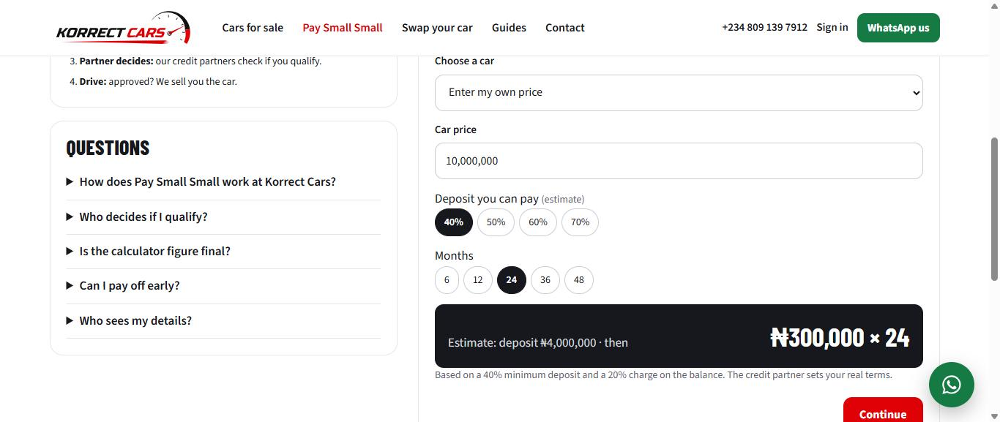

# Korrect Cars

A full-stack car marketplace for Lagos, Nigeria, live at **[korrectcars.com](https://www.korrectcars.com)**. Customers can buy inspected cars outright, pay in instalments through credit partners ("Pay Small Small"), or swap their car with a verified owner.

Rebuilt from a WordPress site into a custom Node.js, Express, React and MySQL application.

**New to the code?** Start with [docs/ARCHITECTURE.md](docs/ARCHITECTURE.md): the business rules, a map of every folder, how a request flows, where to change common things, and how to find and fix a bug.

## Features

- **Car listings** with search, imported from the old WordPress site
- **Homepage by category:** rows for New arrivals, Featured, Under ₦20m, SUVs, Sedans, Premium (₦30m+), Electric & hybrid and Recently sold. A row only appears when it has at least 3 cars, and one car shows in at most 2 rows
- **Category pages** at `/cars/<category>` (for example `/cars/suv`, `/cars/under-20-million`), each with its own title, intro, price answer and structured data for Google and AI assistants
- **"Recommended" order** on Cars for sale (the default): a shuffle that is different for each visitor and changes daily, so every car gets seen, not only the most expensive ones. New arrivals (last 21 days) and featured cars get a head start; sold cars always go last. The other sorts (price, year, recently added) are still in the Sort menu
- **Pay Small Small:** an instalment calculator (40% minimum deposit, 6 to 48 month terms) and a 3-step application sent to credit partners
- **Korrect Swap:** peer-to-peer car exchange, with private document uploads visible only to staff
- **Accounts** with email verification, plus two-factor login (TOTP)
- **Admin dashboard** for cars, swaps, content and site settings
- **SEO:** server-rendered pages, JSON-LD structured data and an XML sitemap
- **Image handling:** uploads resized and converted to WebP

## Tech stack

| Layer | Tools |
| --- | --- |
| Front end | React 18, esbuild |
| Back end | Node.js, Express |
| Database | MySQL (mysql2); tables are created on first start |
| Security | Helmet, rate limiting, CSRF protection, bcrypt password hashing, JWT sessions, Zod input validation |
| Hosting | DirectAdmin Node.js app (Passenger) |

## Project structure

- `app.js`: start file for DirectAdmin "Setup Node.js App"
- `server/`: Express API, MySQL data layer, security, server-rendered SEO; `server/lib/categories.js` holds the car categories
- `client/`: React source (`client/src/lib/rank.js` is the Recommended order); build with `node client/build.js` (outputs to `dist/`)
- `seed/`: cars, blog posts and pages imported from the old WordPress site, loaded when the database is empty
- `uploads/public`: car, blog and swap photos; `uploads/private`: swap papers (staff only)

## Categories and car order

- Categories live in one file, `server/lib/categories.js`, used by both the website and the server (homepage rows, `/cars/<category>` pages, sitemap, `llms.txt` and IndexNow). To add one (for example "7-seaters"), add an entry with a `slug`, `name`, `h1`, `intro`, `faq` question and a `test` that says which cars belong. Set `page: false` for a homepage-only row.
- Category pages with no car in stock (for example Electric & hybrid today) still open, but are marked `noindex` and left out of the sitemap until a car arrives.
- The "Recommended" order is worked out in the browser (`client/src/lib/rank.js`) from a random visitor ID kept in the browser and today's date in Lagos. Pages are sent with `Cache-Control: private, no-cache`, so Cloudflare never serves one visitor's order to another. Search engines see every car in the page HTML regardless of order.
- Links with `?sort=price-desc` (and the other sorts) still work; the default needs no `sort` in the address.

## Running it

1. Copy `.env.example` to `.env` and fill in your MySQL details.
2. Install and build: `npm install`, then `node client/build.js`.
3. Start: `node app.js`.

Real credentials live only in `.env` and server environment variables, never in this repository.

## Deploys and signed commits

- Changes are tested on a private staging copy first, then moved to the live site; the live database is backed up before every update.
- Commits made on the server are signed with the server's GPG key (Korrect Cars Dev, info@korrectcars.com), so GitHub shows them as Verified.
