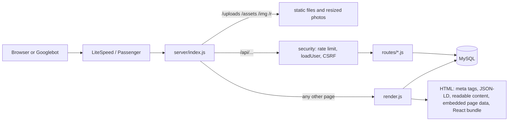

# How the Korrect Cars code works

A guide for any developer joining the project. Read this first, then the file you need to change: every source file starts with a short comment saying what it is for.

The app is one Node.js process. Express serves the API, the React app and search-engine HTML from the same place. MySQL holds the data. There is no separate front-end server and no build step on the server other than `node client/build.js`.

## The business, in five rules

The code follows these rules. If a change breaks one, it is the wrong change.

1. **Buyers first.** The site sells inspected tokunbo and foreign-used cars. Korrect Swap is the only place for sellers.
2. **Korrect Swap is owner to owner.** Owners swap cars with each other (one side may add cash). Korrect Cars checks owners and papers and is the trusted middleman. It never buys, values or takes a car in part payment.
3. **Pay Small Small goes through credit partners.** The site shows estimates only; the partner confirms the final terms.
4. **Delivery anywhere in Nigeria**, priced on WhatsApp.
5. **Sold cars keep their page**, marked Sold, pointing to similar cars in stock.

## Folder map

```
app.js                  start file for DirectAdmin "Setup Node.js App" (Passenger); just loads server/index.js
server/
  index.js              the Express 5 app (async errors reach the error handler by themselves): security headers, static files, /api, sitemap, old WordPress redirects, page rendering, error handler
  config.js             reads environment variables (.env or the panel) and gives safe defaults
  db.js                 MySQL connection (mysql2) and the CREATE TABLE statements; DB_DRIVER=sqlite for local tests
  migrate.js            runs the numbered database changes in server/migrations, once each, in order
  migrations/           001_dealers.js, ... one file per database change; never edit one that has shipped
  render.js             builds the HTML for every page: title, description, structured data, readable content, embedded data
  seed.js, photos.js    first-start import of the old WordPress cars, posts, pages and photos
  tools-*.js            one-time scripts (content updates, slug renames). Each says how to run it and backs up first
  routes/
    public.js           anyone: cars, search facets, enquiries, blog, pages, sign-up, sign-in, password reset, 2FA
    me.js               signed-in customers: saved cars, saved searches, their enquiries
    swap.js             Korrect Swap: listings, offers, masked chat (only when Swap is switched on in settings)
    admin.js            staff area: cars, leads, swap review, private files, users, posts, audit log, settings
    admin-dealers.js    staff: "Dealers to review" (papers, approve / ask for more / reject / pause)
    dealer.js           partner dealers: email-code sign-up, phone code, business papers, their cars (only when the switch is on)
  lib/
    security.js         sessions (JWT cookie), sign-in checks, staff + 2FA check, CSRF guard, rate limits, audit, contact masking
    validate.js         Zod schemas for every form the API accepts
    settings.js         owner-editable settings (phones, credit partners, estimate figures, Swap on/off, staff codes)
    categories.js       car categories and budget bands (shared by server and React)
    titles.js           hides staff codes such as "BF" from public car titles
    vehicle-id.js       VIN and chassis-number rules (shared by server and React)
    registry.js         the VIN register: one live listing per VIN
    car-values.js       turns the car form into database columns (staff and dealer forms)
    sms.js, disposable.js   text codes (Termii) and the temporary-email and common-password lists
    phash.js            photo fingerprints (needs sharp)
    seo.js              robots.txt, llms.txt and IndexNow
    images.js           /r/<width>/... resized WebP photos, made once and kept on disk
    uploads.js          checks and saves uploaded files; private files go to the private folder outside the app (see below)
    mail.js             email through the server's sendmail; logs instead when sendmail is missing
    searches.js         saved-search matching and new-car alert emails
    totp.js             6-digit two-step codes (Google Authenticator and similar); the secret is stored encrypted (AES-256-GCM)
    catalog.js          make -> model -> body type lists for the forms
    pagecopy.js         written copy for Guides, Contact, Swap, VIN check and market pages (shared by server and React)
    sanitize.js         allowlist HTML cleaner for guide content: rebuilds every tag, drops scripts and outside images
    drafts.js           turns a pasted morning draft (Title:/Category:/Sources: then ---) into a guide draft
    covers.js           branded guide covers (SVG template -> 1200x630 WebP, 1080x1080 and 1080x1920 PNG)
    vin.js              free VIN checker: VIN rules, check digit, NHTSA vPIC decode, one-day cache
    inspection-areas.js the five car inspection areas (shared by the car form and the server)
  assets/fonts/         Barlow Condensed (SIL Open Font License) so covers render the same on every server
client/
  build.js              bundles client/src into dist/ with esbuild (hashed file names)
  src/main.jsx          the router: which page component each address shows
  src/lib/core.jsx      shared helpers: router, API calls, embedded data, naira format, photo sizes, WhatsApp links
  src/lib/rank.js       the "Recommended" car order (per visitor, changes daily)
  src/components/       Layout (header, footer, WhatsApp button), Bits (car card, calculator, forms), QuickView, Cascade, Copy (page copy)
  src/pages/            one file per area: Home; Cars (list, compare), CarDetail, PaySmallSmall; Swap; Account; Content; Tools (VIN check, market);
                        staff area: Admin (frame, tabs, overview), AdminAuth (2FA), AdminCars, AdminLeads (leads, swaps), AdminSettings (settings, users, log), AdminGuides, AdminShared
  src/styles.css        the only stylesheet; design tokens at the top
seed/                   the old WordPress export, loaded only into an empty database
uploads/public          car, blog and swap photos (served at /uploads)
../<app folder>-private swap papers and IDs, outside the app folder (PRIVATE_DIR to change it): never served directly, only through the staff file route.
                        Staging and live each have their own, so staging never sees customer files
test/                   automatic tests (node --test test/*.test.js)
docs/                   this guide and README screenshots
```

## What happens on a request



1. **Page addresses** (for example `/cars/2015-toyota-camry-xle`) go to `render.js`. It loads what the page needs from MySQL and sends one HTML file with the title, description, structured data and plain readable content, so Google, AI assistants and AdSense see the real page without running JavaScript. It also embeds the same data as JSON in `<script id="__boot">`, so React shows the page straight away instead of fetching it again.
2. **React** (`client/src/main.jsx`) takes over in the browser and handles later clicks without full reloads. `api()` and `useApi()` in `core.jsx` use the embedded data first (`booted(path)`), then calls the API when needed.
3. **API calls** (`/api/...`) pass three checks in `index.js` before reaching a route: a rate limit, `loadUser` (reads the session cookie) and `csrfGuard` (every POST, PUT or DELETE must send the header `x-requested-with: korrect`; `api()` in `core.jsx` adds it).
4. **Errors**: any error thrown in a route reaches the error handler at the bottom of `index.js`. Server errors get a reference like `KC-3F9A1C`, shown to the user and written to the log next to the cause.

## Where to change common things

| I want to... | Change |
| --- | --- |
| Add a car category or budget page | one entry in `server/lib/categories.js` (read the comment at the top) |
| Change a page title, description or structured data | `server/render.js` (search for the page's address) |
| Change what Google sees in robots.txt or llms.txt | `server/lib/seo.js` |
| Add a field to a form | the Zod schema in `server/lib/validate.js`, the route that saves it, the table in `server/db.js`, then the React form |
| Add an owner-editable setting | `FIELDS` and `current()` in `server/lib/settings.js`; the admin Settings tab shows it automatically |
| Change the Pay Small Small estimate | admin Settings (figures), `bnplPlan()` in `routes/public.js` (the sum) |
| Change a page's look | `client/src/styles.css`; components in `client/src/components/Bits.jsx` |
| Redirect an old address | `LEGACY` in `server/index.js`, or `old_slug` on a car |
| Change the words on Guides, Contact, Swap or VIN check | `server/lib/pagecopy.js` (server HTML and React both read it) |
| Change what HTML a guide may contain | `KEEP` and the attribute rules in `server/lib/sanitize.js`, then run the tests |
| Change the cover design | `svg()` in `server/lib/covers.js` (sizes in `SIZES`) |
| Change the publish rules for guides | `publishProblems()` in `server/routes/admin.js` and the matching checklist in `AdminGuides.jsx` |

## Data

Tables are created on first start by `db.init()` in `server/db.js` (`CREATE TABLE IF NOT EXISTS`). Prices are whole naira in `BIGINT` columns. Every query uses `?` placeholders, never string building.

**Changing the database.** From November 2026 every change is a numbered file in `server/migrations` (`001_dealers.js`, `002_…`). `server/migrate.js` runs each file once, in name order, at start-up and records it in `schema_migrations`; on MySQL it holds a lock so two app processes never run the same change. Write each step so it is safe to run again (`CREATE TABLE IF NOT EXISTS`, check a column before adding it). Run it on staging first; the live database is backed up before the live restart that applies it. Never edit a file that has shipped: add the next one.

| Table | Holds |
| --- | --- |
| `cars` | listings: title (may end in a staff code), slug, make, model, price, photos (JSON), status pending (a partner dealer waiting for approval), available, reserved, sold or hidden, `old_slug` for redirects, `dealer_id` (who sells it; defaults to 1, Korrect Cars), `vehicle_id_ref` (its VIN in the register), `live_key` (filled by the database while the car is pending, available or reserved; UNIQUE, so one live listing per VIN), `vin_photo` (private), `moved_from` / `moved_at` (cars handed over by staff with "Move cars to this dealer"; they do not count towards the 50-car limit) |
| `vehicle_ids` | the VIN register: every VIN or chassis number ever listed, once (type + value unique), with its check-digit result and a `locked` flag |
| `car_photo_hashes` | a fingerprint of each partner car photo (spotting the same photos on two listings) |
| `signup_codes`, `phone_otps` | hashed 6-digit codes: email codes sent before a dealer account exists, and phone codes; with tries and expiry |
| `dealer_documents` | a dealer's CAC certificate and other papers (files in the private folder), with who reviewed them and `delete_after` (12 months after the decision) |
| `dealers` | businesses that sell on the site. Korrect Cars is dealer 1. Status draft, pending_review, approved, rejected or suspended; one dealer per CAC type + number (RC and BN are separate registers); `state` and `lga` from `server/lib/ng-lgas.js` (all 774 LGAs). A car is where its dealer is: searches by state or LGA read the dealer's |
| `dealer_members` | which users work for which dealer, with a role: owner, manager or lister |
| `verification_events` | every dealer check and staff decision, one row each, never edited |
| `schema_migrations` | which numbered database changes have run |
| `users` | customers and staff: bcrypt password hash, role, verified flag, TOTP secret, `token_version` (raise it to sign a user out everywhere) |
| `enquiries` | leads from forms and WhatsApp clicks, with status and notes |
| `swap_listings`, `offers`, `messages` | Korrect Swap: an owner's car, offers between owners, chat with phone numbers and emails masked until an offer is accepted |
| `posts`, `pages` | guides, blog and content pages (some imported from WordPress) |
| `saved_cars`, `saved_searches` | customer favourites and search alerts |
| `email_tokens` | hashed, time-limited codes for email checks and password resets |
| `settings` | key/value pairs edited in admin |
| `audit` | who did what in the staff area |

## Security model

- **Sessions**: a signed JWT in an HttpOnly cookie (`kc_session`). Customers stay signed in for 7 days, staff for 12 hours. Changing `users.token_version` ends every session for that user.
- **Staff area**: `requireStaff()` in `security.js` needs the right role, two-step login set up, and the code entered in this session. Roles: `admin`, `sales` (old name `moderator`) and `editor`. The staff sign-in address comes from `ADMIN_PATH`, which is set only on the server and is not linked anywhere on the site. Without it (or with fewer than 12 characters) the staff pages stay off. Staff roles are given only by a server command: `node server/tools-make-staff.js <email> <admin|sales|editor|user>`. Nobody becomes staff by signing up.
- **Input**: every API body is checked by a Zod schema; keys such as `__proto__` are stripped first.
- **Headers**: Helmet with a strict Content-Security-Policy that uses a per-request nonce. Only Google Analytics, AdSense and Google Fonts are allowed in.
- **Uploads**: file types are checked by content, photos are re-encoded, and private files get random names, live outside the app folder and are served only through the staff route.
- **Two-step secrets** are encrypted in the database with AES-256-GCM. The key is `TOTP_KEY` (64 hex characters) if set, otherwise a random key in `.totp-key` inside the private folder outside the app (never in Git, never in the web folder; the deploy also copies it into the backups folder). Losing that file means staff set up two-step login again; it does not expose anything.
- **Packages**: exact versions are pinned in `package-lock.json`. `npm audit --omit=dev` should report 0 vulnerabilities.
- **Health check**: `GET /api/health` answers 200 when the app and database are up, 503 when the database is down. Point an uptime monitor at it.
- **Secrets** never go in Git. They live in the panel's environment variables or `.htaccess` `SetEnv` lines on the server.

## This repository is public: what must never be in it

Anyone can read this code and its full history, so treat every commit as published for good. Removing something
later does not remove it from history.

- **Never commit:** passwords, database details, `JWT_SECRET`, API keys, `.env`, `.htaccess`, `.session-secret`,
  database dumps, customer files (`uploads/`), server logs, private keys.
- **Never write in code, docs or commit messages:** the staff sign-in address (`ADMIN_PATH`), hosting panel
  addresses and usernames, server folder paths, the staging address, staff names or emails.
- **Public by design (fine to keep):** the Google Analytics and AdSense IDs, the business phone numbers and email,
  and the rules in this guide. They already appear on every page of the site.
- `.gitignore` already blocks `.env`, `.session-secret`, `uploads/`, `dist/`, logs and zips. Before every commit,
  run `git diff --cached` and read what is going out.
- If a secret is ever committed by mistake: change it on the server straight away (new password or key). Deleting
  the commit is not enough, because copies of the history may already exist.

## Guides: how content gets published (AdSense rules)

AdSense rejected the site in October 2026 for thin content. These rules keep it from happening again:

1. A scheduled Claude task researches Nigeria car and EV topics each morning and writes one draft, with sources, in the import format (`server/lib/drafts.js`).
2. Staff paste it into **Import today's draft** in the staff area. It becomes a **draft**: drafts are never public, never in the sitemap and never in llms.txt.
3. Staff edit it and add **what only Korrect Cars can add**: our photos, an inspection finding or a real price from stock.
4. **Publish** is refused until the guide has a cover, an excerpt of 40+ characters, a source, our own input and 300+ words. The first publish sets today's date.
5. Covers are generated, never copied. "Replace image" frames one of our own photos, and the credit and licence are required.
6. Keep to 2–3 reviewed guides a week until AdSense approves. The staff area shows the weekly count.

## Tests

`node --test test/*.test.js` runs the automated tests (54): database changes (run once, Korrect Cars is dealer 1 and owns every car, a restart changes nothing, one dealer per business number, the database refuses a second live listing of a VIN), partner dealers end to end (temporary emails refused, at most 3 email codes an hour per address and 10 per connection, wrong codes, weak passwords, phone codes with 3 a day per number, CAC papers kept private, CAC number used once, staff review and approval, VIN rules, VIN_TAKEN, ten saves of one VIN at once giving exactly one listing, dealers kept apart, the 50-car limit, waiting cars kept off the site, the staff car form using the same register), the API end to end on a throwaway SQLite database (health check, CSRF guard, email confirmation, account lock after 5 wrong passwords, customers kept out of the staff API, staff two-step login with the encrypted secret and backup codes, editor vs admin, Pay Small Small figures, validation), two-step codes (RFC 6238 vector, encryption), the HTML cleaner against script-injection tricks, draft import and VIN rules. Add a test when you fix a bug.

## Running it on your computer

```
npm ci && (cd client && npm install)
node client/build.js
DB_DRIVER=sqlite SQLITE_FILE=/tmp/kc.db PORT=3123 MAIL_DISABLED=1 ADSENSE_CLIENT= GA_ID= node app.js
```

SQLite mode needs Node 22 or newer and creates a throwaway database, filled from `seed/` on first start. Emails are written to the log instead of being sent.

## Shipping a change

1. Make the change and test it locally on phone and desktop widths.
2. Commit in the owner's name only (`Korrect Cars Dev <info@korrectcars.com>`). Don't add co-author lines.
3. Apply it on the private **staging** copy first. The server signs the commit with its GPG key, so GitHub shows it as Verified, then pushes it to GitHub.
4. Before the **live** site is touched, back up the live database (`mysqldump`). If the backup comes out empty, stop.
5. On live: `git merge --ff-only` from staging, `node client/build.js`, then `touch tmp/restart.txt` to restart.
6. Check the live site in a browser.

Never copy customer data to staging.

## Finding and fixing a bug

- **The user saw "Something went wrong (ref KC-XXXXXX)"**: search the server's error log (`stderr.log` in the app folder) for that code. The line shows the address, the user and the full error.
- **A page shows old content**: the browser has the old bundle. File names in `dist/assets` change on every build, so a hard refresh fixes it; if not, check that the build ran.
- **A form is refused with "Bad request origin."**: the request came without `x-requested-with: korrect`. Use `api()` from `core.jsx`, not a bare `fetch`.
- **The staff area says "Set up two-step login"**: that is `requireStaff()` working as intended. Set up the code in the account page.
- **A category or budget page is missing from Google**: it has fewer than `MIN_INDEX` (3) cars in stock, so it is marked noindex on purpose.
- **Photos load slowly**: use `rs()` / `srcset()` from `core.jsx` so the browser gets a resized WebP from `/r/<width>/...`.

## The light page (when the app cannot run)

Every public page is first sent as plain HTML from `render.js`: header, the page's real content (cars with photos and prices, guide text, contact details) and footer. A small script in `client/index.html` hides it while the app loads, so there is no flash. If the app has not started within 6 seconds, or its file fails to download, the light page is shown instead. Visitors with scripts switched off see it straight away. Search engines and AI crawlers always read it. When the app starts, it replaces the light page.

## Partner dealers (marketplace)

The plan is in the developer brief and the clickable mockup (both shared by the owner). Work ships in milestones, staging first, with the **Partner dealers (marketplace)** switch in admin Settings On on staging and Off on live until the owner chooses the launch day. While it is off, every `/api/dealer` address and every dealer page answers "not found".

Done so far:
- **Milestone 1**: numbered database changes, the `dealers` tables, Korrect Cars as dealer 1 owning every car, the switch.
- **Milestone 2, sign-up** (`server/routes/dealer.js`, page `client/src/pages/Dealer.jsx`): the dealer types an email and gets a 6-digit code (15 minutes, 5 tries); no account exists until the code is entered. Temporary inboxes are refused (`server/lib/disposable.js`). The answer is the same for every email: an address that already has an account gets a "please sign in" email instead of a code. Then name, Nigerian mobile and a password of 10+ characters that is not a common one. Then a text code to the phone (`server/lib/sms.js`, Termii; set `TERMII_API_KEY`, and optionally `TERMII_SENDER_ID`). Without a key, staging shows the code on the page marked as a test code and the live site refuses the phone step. Then the business: name, RC/BN number (one dealer per number), state, address and the CAC certificate, saved in the private folder. The dealer waits as `pending_review`; staff get an email.
- **Staff review**: "Dealers to review" in the staff area (`server/routes/admin-dealers.js`, `client/src/pages/AdminDealers.jsx`), open to every staff role, never to dealers. Opening a paper is written to the activity log. Approve (their waiting cars go live), ask for more, reject or pause (their cars come off the site and stop holding their VINs). Anything but approve needs a note, which the dealer sees and gets by email.
- **Milestone 3, VIN register and dealer cars**: `server/lib/vehicle-id.js` holds the VIN rules for both server and browser (17 characters, no I/O/Q, position 10 never U/Z/0; a wrong check digit is an error on US and Chinese VINs, a warning elsewhere; Japanese chassis numbers accepted with a warning). `server/lib/registry.js` registers each VIN once, and the UNIQUE index on `cars.live_key` makes the database itself refuse a second live listing (`409 VIN_TAKEN`, with `canClaim`), even when two saves arrive at the same moment. The staff car form goes through the same register; an old VIN that breaks today's rules may stay as it is when a car is edited. Dealers add cars VIN first (`GET /api/dealer/vin-check` says free, yours or taken, and fills make, model and year from the free US decoder). A new dealer may have 50 cars for sale in their first 3 months (`dealers.live_limit` overrides). Photos get a fingerprint when sharp is installed (`server/lib/phash.js`).

- **Since then**: LGA dropdown that follows the chosen state (sign-up), search by state and LGA (home search box and every cars page), "My dealer page" in the header for signed-in dealers, and an administrators-only "Move cars to this dealer" for handing Korrect Cars' stock to Buffy (staff codes such as BF come off the titles).

- **VIN auto-fill** (`server/lib/vin-prefill.js`, `client/src/lib/prefill.js`): "Check VIN" on the dealer form and "Fill from VIN" on the staff form fill every empty field the record supports: title, make, model, year, trim, body, engine, gearbox, drive, fuel, doors, seats, where it was built, standard safety features and a short factual starter description. The US government decoder (NHTSA vPIC) covers every US/Canada-market car whatever the brand; for other VINs the maker code (first 3 characters) still gives the make and country, and North American and Asian VINs give the model year. Nothing is guessed. The public VIN check shows the same basics and recognises Japanese chassis numbers. Full European-market decoding would need a paid VIN service.
- **Model facts** (`server/lib/model-facts.js`): fills the gaps the US record leaves ("4x2" drive, no gearbox, factory codes such as ASV50 where a trim should be) from what every car of a model generation shares, for the models most sold in Nigeria, and decodes Toyota/Lexus factory codes (also the model code at the start of a Japanese chassis number). When a generation came with several engines, drives or gearboxes, the form shows them as tap-to-pick choices (picking an engine sets its gearbox and fuel); nothing is guessed. The exterior colour is never in a VIN, so it is picked from a short list.
- **Car form pieces** (`client/src/components/CarFields.jsx`, shared by the dealer and staff forms): price with "Call for price", mileage with a miles/km unit, colour and interior pick lists, feature ticks, VIN choices, and "Write it for me", which writes a plain description from the details on the form only.
- **Call for price** (`server/lib/price.js`, shared with the web app): stored as price 0. Every page shows "Call for price"; price filters, budget pages, price ranges, Pay Small Small figures and the search-engine Offer use only cars with a price. A car shown for sale must have its mileage and a price or "Call for price" (`lib/car-values.js`); hidden drafts may wait. A dealer's car location is set from the dealer's LGA and State.
- **Emails** carry the logo inside the message (`server/assets/email-logo.png`, Content-ID), so it shows on any device.
- **Builds** go into `dist/assets-next` and replace the live files only when they succeed; esbuild is limited to 2 threads for the shared server.

Next: milestone 4 (ownership claims for a taken VIN, flags for near-identical VINs and the same photos on two listings).

## Known work left

- More tests for the React pages (the API is covered)
- Optional: draw the React pages on the server too (full server-side rendering), so the switch from the light page is seamless
