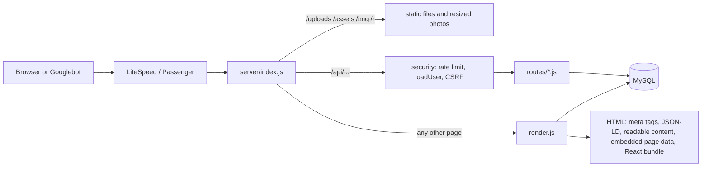

# How the Korrect Cars code works

A guide for any developer joining the project. Read this first, then the file you need to change: every source file starts with a short comment saying what it is for.

The app is one Node.js process. Express serves the API, the React app and search-engine HTML from the same place. MySQL holds the data. There is no separate front-end server and no build step on the server other than `node client/build.js`.

## The business, in five rules

The code follows these rules. If a change breaks one, it is the wrong change.

1. **Buyers first.** The site sells inspected tokunbo and foreign-used cars. Korrect Swap is the only place for sellers.
2. **Korrect Swap is owner to owner.** Owners swap cars with each other (one side may add cash). Korrect Cars checks owners and papers and is the trusted middleman. It never buys, values or takes a car in part payment.
3. **Pay Small Small goes through credit partners.** The site shows estimates only; the partner confirms the final terms.
4. **Delivery anywhere in Nigeria**, priced on WhatsApp.
5. **Sold cars keep their page**, marked Sold, pointing to similar cars in stock.

## Folder map

```
app.js                  start file for DirectAdmin "Setup Node.js App" (Passenger); just loads server/index.js
server/
  index.js              the Express app: security headers, static files, /api, sitemap, old WordPress redirects, page rendering, error handler
  config.js             reads environment variables (.env or the panel) and gives safe defaults
  db.js                 MySQL connection (mysql2) and the CREATE TABLE statements; DB_DRIVER=sqlite for local tests
  render.js             builds the HTML for every page: title, description, structured data, readable content, embedded data
  seed.js, photos.js    first-start import of the old WordPress cars, posts, pages and photos
  tools-*.js            one-time scripts (content updates, slug renames). Each says how to run it and backs up first
  routes/
    public.js           anyone: cars, search facets, enquiries, blog, pages, sign-up, sign-in, password reset, 2FA
    me.js               signed-in customers: saved cars, saved searches, their enquiries
    swap.js             Korrect Swap: listings, offers, masked chat (only when Swap is switched on in settings)
    admin.js            staff area: cars, leads, swap review, private files, users, posts, audit log, settings
  lib/
    security.js         sessions (JWT cookie), sign-in checks, staff + 2FA check, CSRF guard, rate limits, audit, contact masking
    validate.js         Zod schemas for every form the API accepts
    settings.js         owner-editable settings (phones, credit partners, estimate figures, Swap on/off, staff codes)
    categories.js       car categories and budget bands (shared by server and React)
    titles.js           hides staff codes such as "BF" from public car titles
    seo.js              robots.txt, llms.txt and IndexNow
    images.js           /r/<width>/... resized WebP photos, made once and kept on disk
    uploads.js          checks and saves uploaded files; private files go to uploads/private
    mail.js             email through the server's sendmail; logs instead when sendmail is missing
    searches.js         saved-search matching and new-car alert emails
    totp.js             6-digit two-step codes (Google Authenticator and similar)
    catalog.js          make -> model -> body type lists for the forms
client/
  build.js              bundles client/src into dist/ with esbuild (hashed file names)
  src/main.jsx          the router: which page component each address shows
  src/lib/core.jsx      shared helpers: router, API calls, embedded data, naira format, photo sizes, WhatsApp links
  src/lib/rank.js       the "Recommended" car order (per visitor, changes daily)
  src/components/       Layout (header, footer, WhatsApp button), Bits (car card, calculator, forms), QuickView, Cascade
  src/pages/            one file per area: Home, Cars (list, detail, Pay Small Small, compare), Swap, Account, Content, Admin
  src/styles.css        the only stylesheet; design tokens at the top
seed/                   the old WordPress export, loaded only into an empty database
uploads/public          car, blog and swap photos (served at /uploads)
uploads/private         swap papers and IDs: never served directly, only through the staff file route
docs/                   this guide and README screenshots
```

## What happens on a request



1. **Page addresses** (for example `/cars/2015-toyota-camry-xle`) go to `render.js`. It loads what the page needs from MySQL and sends one HTML file with the title, description, structured data and plain readable content, so Google, AI assistants and AdSense see the real page without running JavaScript. It also embeds the same data as JSON in `<script id="__boot">`, so React shows the page straight away instead of fetching it again.
2. **React** (`client/src/main.jsx`) takes over in the browser and handles later clicks without full reloads. `api()` and `useApi()` in `core.jsx` use the embedded data first (`booted(path)`), then calls the API when needed.
3. **API calls** (`/api/...`) pass three checks in `index.js` before reaching a route: a rate limit, `loadUser` (reads the session cookie) and `csrfGuard` (every POST, PUT or DELETE must send the header `x-requested-with: korrect`; `api()` in `core.jsx` adds it).
4. **Errors**: any error thrown in a route reaches the error handler at the bottom of `index.js`. Server errors get a reference like `KC-3F9A1C`, shown to the user and written to the log next to the cause.

## Where to change common things

| I want to... | Change |
| --- | --- |
| Add a car category or budget page | one entry in `server/lib/categories.js` (read the comment at the top) |
| Change a page title, description or structured data | `server/render.js` (search for the page's address) |
| Change what Google sees in robots.txt or llms.txt | `server/lib/seo.js` |
| Add a field to a form | the Zod schema in `server/lib/validate.js`, the route that saves it, the table in `server/db.js`, then the React form |
| Add an owner-editable setting | `FIELDS` and `current()` in `server/lib/settings.js`; the admin Settings tab shows it automatically |
| Change the Pay Small Small estimate | admin Settings (figures), `bnplPlan()` in `routes/public.js` (the sum) |
| Change a page's look | `client/src/styles.css`; components in `client/src/components/Bits.jsx` |
| Redirect an old address | `LEGACY` in `server/index.js`, or `old_slug` on a car |

## Data

Tables are created on first start by `db.init()` in `server/db.js` (`CREATE TABLE IF NOT EXISTS`). Prices are whole naira in `BIGINT` columns. Every query uses `?` placeholders, never string building.

| Table | Holds |
| --- | --- |
| `cars` | listings: title (may end in a staff code), slug, make, model, price, photos (JSON), status available, reserved or sold, `old_slug` for redirects |
| `users` | customers and staff: bcrypt password hash, role, verified flag, TOTP secret, `token_version` (raise it to sign a user out everywhere) |
| `enquiries` | leads from forms and WhatsApp clicks, with status and notes |
| `swap_listings`, `offers`, `messages` | Korrect Swap: an owner's car, offers between owners, chat with phone numbers and emails masked until an offer is accepted |
| `posts`, `pages` | guides, blog and content pages (some imported from WordPress) |
| `saved_cars`, `saved_searches` | customer favourites and search alerts |
| `email_tokens` | hashed, time-limited codes for email checks and password resets |
| `settings` | key/value pairs edited in admin |
| `audit` | who did what in the staff area |

## Security model

- **Sessions**: a signed JWT in an HttpOnly cookie (`kc_session`). Customers stay signed in for 7 days, staff for 12 hours. Changing `users.token_version` ends every session for that user.
- **Staff area**: `requireStaff()` in `security.js` needs the right role, two-step login set up, and the code entered in this session. Roles: `admin`, `sales` (old name `moderator`) and `editor`. The staff sign-in address comes from `ADMIN_PATH`, which is set only on the server and is not linked anywhere on the site. Without it (or with fewer than 12 characters) the staff pages stay off. Staff roles are given only by a server command: `node server/tools-make-staff.js <email> <admin|sales|editor|user>`. Nobody becomes staff by signing up.
- **Input**: every API body is checked by a Zod schema; keys such as `__proto__` are stripped first.
- **Headers**: Helmet with a strict Content-Security-Policy that uses a per-request nonce. Only Google Analytics, AdSense and Google Fonts are allowed in.
- **Uploads**: file types are checked by content, photos are re-encoded, and private files get random names and are served only through the staff route.
- **Secrets** never go in Git. They live in the panel's environment variables or `.htaccess` `SetEnv` lines on the server.

## This repository is public: what must never be in it

Anyone can read this code and its full history, so treat every commit as published for good. Removing something
later does not remove it from history.

- **Never commit:** passwords, database details, `JWT_SECRET`, API keys, `.env`, `.htaccess`, `.session-secret`,
  database dumps, customer files (`uploads/`), server logs, private keys.
- **Never write in code, docs or commit messages:** the staff sign-in address (`ADMIN_PATH`), hosting panel
  addresses and usernames, server folder paths, the staging address, staff names or emails.
- **Public by design (fine to keep):** the Google Analytics and AdSense IDs, the business phone numbers and email,
  and the rules in this guide. They already appear on every page of the site.
- `.gitignore` already blocks `.env`, `.session-secret`, `uploads/`, `dist/`, logs and zips. Before every commit,
  run `git diff --cached` and read what is going out.
- If a secret is ever committed by mistake: change it on the server straight away (new password or key). Deleting
  the commit is not enough, because copies of the history may already exist.

## Running it on your computer

```
npm install && (cd client && npm install)
node client/build.js
DB_DRIVER=sqlite SQLITE_FILE=/tmp/kc.db PORT=3123 MAIL_DISABLED=1 ADSENSE_CLIENT= GA_ID= node app.js
```

SQLite mode needs Node 22 or newer and creates a throwaway database, filled from `seed/` on first start. Emails are written to the log instead of being sent.

## Shipping a change

1. Make the change and test it locally on phone and desktop widths.
2. Commit in the owner's name only (`Korrect Cars Dev <info@korrectcars.com>`). Don't add co-author lines.
3. Apply it on the private **staging** copy first. The server signs the commit with its GPG key, so GitHub shows it as Verified, then pushes it to GitHub.
4. Before the **live** site is touched, back up the live database (`mysqldump`). If the backup comes out empty, stop.
5. On live: `git merge --ff-only` from staging, `node client/build.js`, then `touch tmp/restart.txt` to restart.
6. Check the live site in a browser.

Never copy customer data to staging.

## Finding and fixing a bug

- **The user saw "Something went wrong (ref KC-XXXXXX)"**: search the server's error log (`stderr.log` in the app folder) for that code. The line shows the address, the user and the full error.
- **A page shows old content**: the browser has the old bundle. File names in `dist/assets` change on every build, so a hard refresh fixes it; if not, check that the build ran.
- **A form is refused with "Bad request origin."**: the request came without `x-requested-with: korrect`. Use `api()` from `core.jsx`, not a bare `fetch`.
- **The staff area says "Set up two-step login"**: that is `requireStaff()` working as intended. Set up the code in the account page.
- **A category or budget page is missing from Google**: it has fewer than `MIN_INDEX` (3) cars in stock, so it is marked noindex on purpose.
- **Photos load slowly**: use `rs()` / `srcset()` from `core.jsx` so the browser gets a resized WebP from `/r/<width>/...`.

## Known work left

These are tracked in the developer brief:

- Automatic tests
- `package-lock.json` with `npm ci`
- Encrypted 2FA secrets
- Size limits on list inputs
- `/api/health`
- Splitting `Cars.jsx` and `Admin.jsx`
- Keeping private uploads outside the app folder
- Replacing the router patch at the top of `index.js`
